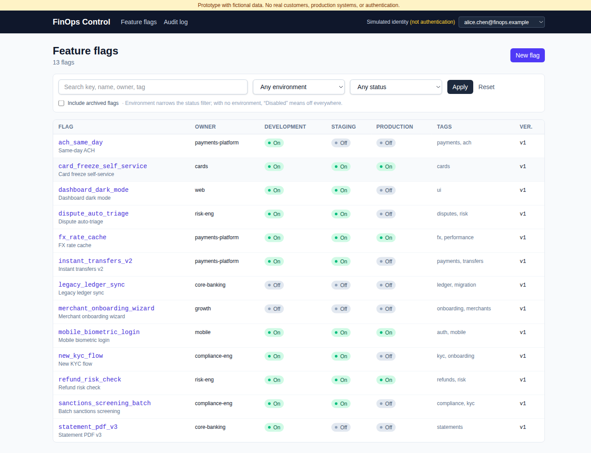
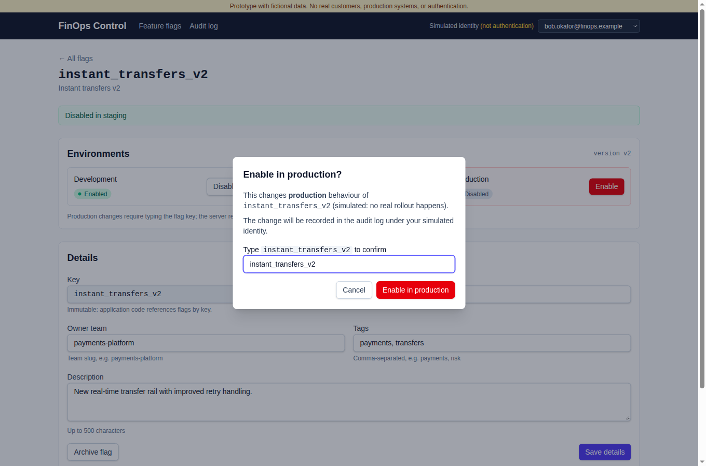
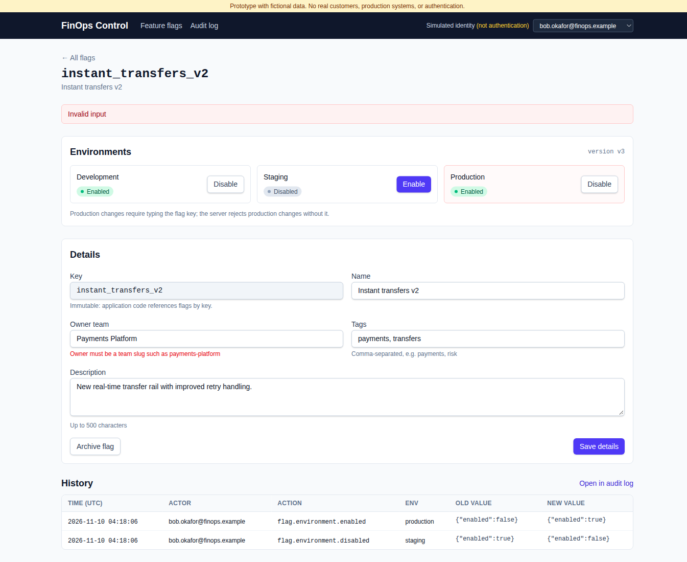
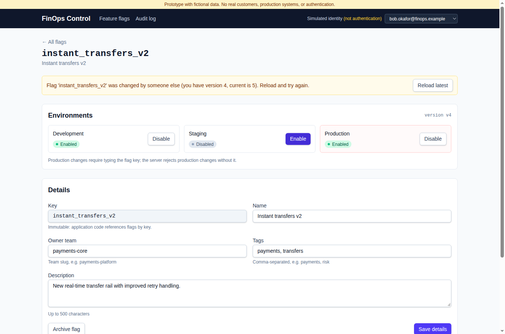
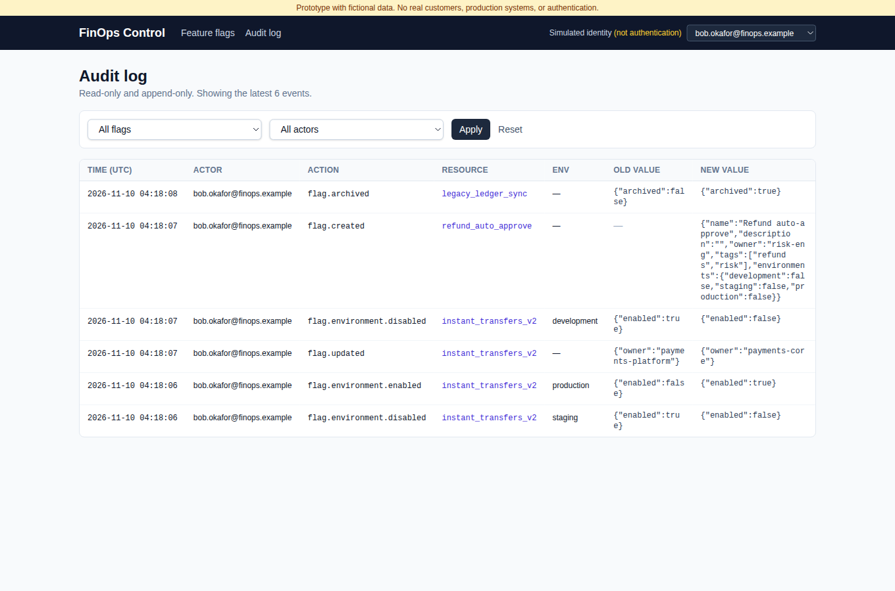

# FinOps Control

A feature-flag administration prototype for a **fictional** fintech. Built as a proof of concept for replacing low-code internal tools (e.g. Power Apps) with conventional, customer-owned software: Next.js + TypeScript + Tailwind + SQLite.

> **Prototype only.** Fictional data, no real customers, no production integrations, no real rollout infrastructure, and **no authentication**. The "simulated identity" selector is a demo convenience and can be spoofed by anyone. See [Known limitations](#known-limitations) and the [Production-hardening checklist](#production-hardening-checklist).



## Quick start

Requires **Node.js 22+** (see `.nvmrc`). `better-sqlite3` is a native module; prebuilt binaries cover Linux/macOS/Windows on Node 22.

```bash
npm install
npm run db:reset     # creates data/finops.db with 13 seeded flags and an empty audit log
npm run dev          # http://localhost:3000
```

Other commands:

```bash
npm test             # vitest: service-layer + API route tests (in-memory SQLite)
npm run lint         # eslint
npm run typecheck    # tsc --noEmit
npm run build && npm start   # production build
```

The database is created and seeded automatically on first request if it does not exist. `DATABASE_PATH` overrides the default location (`./data/finops.db`). `npm run db:reset` resets in place, so it is safe to run while the dev server is up.

### Reproducible demo script (about 5 minutes)

1. `npm run db:reset && npm run dev`, open http://localhost:3000.
2. **Filter**: search `kyc`, environment `production`, status `Disabled` → `new_kyc_flow`, `sanctions_screening_batch`.
3. **Simulated identity**: pick `bob.okafor@finops.example` in the header.
4. Open `instant_transfers_v2`. **Disable in staging** (no dialog for non-production).
5. **Enable in production** → the dialog requires typing `instant_transfers_v2`. Confirm.
6. **Refresh** the page → state persists.
7. **Validation**: set Owner team to `Payments Platform` → *Save details* → server rejects it with a field error.
8. **Concurrency**: open the same flag in a second tab, toggle something there, then toggle in the first tab → 409 "changed by someone else" banner with *Reload latest*.
9. **Create** a flag via *New flag* (try an invalid key such as `Bad-Key` first).
10. **Archive** `legacy_ledger_sync` (allowed because it is disabled everywhere). Try archiving `refund_risk_check` → rejected because it's enabled.
11. **Audit log** → every successful change with actor, action, resource, environment, old/new value and timestamp. Filter by flag or actor.
12. **API bypass check**: the server enforces production confirmation, not just the UI:
    ```bash
    curl -s -X PUT localhost:3000/api/flags/new_kyc_flow/environments/production \
      -H 'content-type: application/json' -d '{"enabled":true,"expectedVersion":1}'
    # → 428 {"error":{"code":"CONFIRMATION_REQUIRED",...}}
    ```

| Production confirmation | Server-side validation | Version conflict | Audit log |
|---|---|---|---|
|  |  |  |  |

**Recorded walkthrough:** a two-minute browser recording of the main flows, with step-by-step results, is in [`docs/walkthrough/`](docs/walkthrough/README.md).

## What's implemented

| Capability | Where |
|---|---|
| Registry of 13 fictional flags (incl. `instant_transfers_v2`, `new_kyc_flow`, `refund_risk_check`) | `src/server/seed.ts` |
| Search (key/name/owner/tag) + environment + enabled-status filters | `listFlags` in `src/server/flags.ts`, `/flags` |
| View/edit metadata (name, description, owner, tags) | `updateFlag`, `/flags/[key]` |
| Per-environment enable/disable (development, staging, production) | `setFlagEnvironment` |
| Production changes need `confirmProduction` = flag key, **enforced on the server** | `setFlagEnvironment`; UI: `ConfirmDialog` |
| Create flag (starts disabled everywhere) | `createFlag`, `/flags/new` |
| Archive-only deletion (must be disabled everywhere; key never reused; DB trigger blocks `DELETE`) | `archiveFlag`, `src/server/db.ts` |
| Immutable flag keys (service check + DB trigger) | `updateFlag`, `src/server/db.ts` |
| Optimistic concurrency: every mutation sends `expectedVersion`; stale → `409 VERSION_CONFLICT` | `assertVersion` / `bumpVersion` |
| Atomic state change + audit event (single SQLite transaction) | every mutation in `src/server/flags.ts` |
| Append-only audit log (DB triggers block `UPDATE`/`DELETE`), read-only UI with flag/actor filters | `src/server/audit.ts`, `/audit` |
| Centralized validation (zod) with explicit rules | `src/server/validation.ts` |
| Simulated actor from `x-demo-actor` header or `finops_demo_actor` cookie, allow-listed | `src/server/actor.ts` |
| CI: lint, typecheck, tests, build | `.github/workflows/ci.yml` |

**Not implemented (by design):** SSO/real auth, RBAC, approval workflow, SDK/evaluation API for applications to read flags, targeting/percentage rollouts, real KYC/payment integrations, un-archive.

### Validation rules

| Field | Rule |
|---|---|
| `key` | `^[a-z][a-z0-9_]{2,63}$` (3-64 chars, lowercase snake_case, starts with a letter); unique forever; immutable |
| `name` | trimmed, 3-80 chars |
| `description` | trimmed, ≤ 500 chars |
| `owner` | team slug `^[a-z][a-z0-9-]{1,39}$` (e.g. `payments-platform`) |
| `tags` | ≤ 10, unique, each `^[a-z0-9-]{1,24}$` |
| `environment` | `development` \| `staging` \| `production` |
| `enabled` | boolean (strings like `"true"` are rejected) |
| `expectedVersion` | positive integer, must equal current version |
| `confirmProduction` | required for production changes; must equal the flag key |
| Unknown fields | rejected (strict schemas) |
| Archived flags | read-only |
| Archive | only when disabled in all environments |

### API

All responses are JSON. Errors: `{ "error": { "code", "message", "details?": [{ "path", "message" }] } }`.

| Method & path | Body | Notes |
|---|---|---|
| `GET /api/flags?q=&environment=&status=all\|enabled\|disabled&includeArchived=true` | | |
| `POST /api/flags` | `{ key, name, owner, description?, tags? }` | 201 |
| `GET /api/flags/:key` | | |
| `PATCH /api/flags/:key` | `{ expectedVersion, name?, description?, owner?, tags? }` | `key` in body → 400 |
| `PUT /api/flags/:key/environments/:env` | `{ enabled, expectedVersion, confirmProduction? }` | production without confirmation → 428 |
| `POST /api/flags/:key/archive` | `{ expectedVersion }` | enabled anywhere → 422 |
| `GET /api/audit?flag=&actor=&limit=` | | newest first |

Status codes: 400 validation · 404 not found · 409 version conflict / duplicate key · 422 invalid state · 428 confirmation required.

## Architecture

```
src/
  app/                    UI (server components read via services; client components mutate via the API)
    api/                  thin route handlers: parse request -> call service -> map errors
    flags/, audit/        pages
  components/ui/          reusable: DataTable, StatusBadge, ConfirmDialog, Field, Button, Alert
  components/             AuditTable, ActorSelect
  lib/                    types shared by client and server, fetch helper
  server/
    validation.ts         all input rules (zod)
    audit.ts              the only writer of audit events + audit queries
    flags.ts              business rules: versioning, confirmation, archive, transactions
    actor.ts              simulated identity (untrusted)
    db.ts, seed.ts        SQLite schema, triggers, seed data
tests/                    vitest: service rules + API route handlers
```

- **UI → service → persistence.** Route handlers and pages never write SQL. Services take a `db` handle, so tests run against an in-memory SQLite.
- **One write path.** Every mutation is `parse(schema) → transaction { load → assertVersion → assertActive → write → bumpVersion → recordAudit }`.
- **Defense in depth** in the schema: append-only audit triggers, immutable key trigger, no-delete trigger on flags, CHECK constraints on environment and booleans.

## Reusing this for KYC review, refunds, and future internal tools

Most of the code isn't specific to feature flags. A new internal tool gets these as-is:

| Building block | Reuse |
|---|---|
| `DataTable`, `StatusBadge`, `Field`, `Button`, `Alert`, `ConfirmDialog` | List, filter and form screens for any queue |
| `recordAudit` / `listAuditEvents` / `AuditTable` | Already generic: `resource_type` + `resource_key`. A KYC case writes `resource_type = 'kyc_case'` |
| `parse()` + zod schemas + `ServiceError` → HTTP mapping (`handle`) | Same validation/error contract for every tool |
| Optimistic concurrency (`version` + `expectedVersion`) | Stops two reviewers acting on the same case or refund |
| Typed confirmation (`ConfirmDialog` + server check) | High-risk actions, e.g. refunds above a threshold or rejecting a KYC application |
| Simulated actor → replace once with SSO | One identity integration shared by every tool |

**KYC review queue sketch:** a `kyc_cases` table (`status: pending|in_review|approved|rejected|escalated`, `assignee`, `risk_score`, `version`). `src/server/kyc.ts` gets `claimCase`, `approveCase`, `rejectCase(reason)` and `escalateCase`, each following the same transaction + `assertVersion` + `recordAudit` pattern, with a state-machine check in place of `assertActive`. The UI is a `DataTable` filtered by status/assignee, a detail page with action buttons, and `ConfirmDialog` with a required reason for rejection.

**Refunds dashboard sketch:** a `refunds` table plus a typed confirmation for amounts above a configurable threshold. Same audit, validation and concurrency code.

To scale past 3 tools, the next step is extracting `server/{audit,validation,errors,http,actor}.ts` and `components/ui` into a shared internal package (monorepo workspace), with a template repo that new tools start from.

## Known limitations

- **No authentication or authorization.** Identity is a client-selected header/cookie from a fixed allow-list. Anyone can act as anyone. There is **no RBAC**; everyone can change production.
- Production "confirmation" proves intent, not authority. No approval or four-eyes workflow.
- Audit log immutability is enforced only by SQLite triggers in a local file. Anyone with file access can edit or delete it. There is no tamper-evidence (hash chain/WORM storage) and no export.
- SQLite single-file storage: one-node only; no backups, migrations framework, or retention policy.
- No flag evaluation API/SDK. Applications can't consume these flags, and toggles have no real effect.
- No rate limiting, CSRF tokens (relies on SameSite=Lax cookie and JSON content type), CSP headers, or request size limits.
- No pagination: the audit view shows the latest 200 events.
- No un-archive, bulk actions, or flag dependencies.
- UI tests are a local Playwright smoke script run during development. They aren't committed or run in CI. CI runs unit/API tests only.

## Production-hardening checklist

- [ ] SSO via the company IdP (OIDC/SAML, e.g. Entra ID/Okta). Derive the actor from a server-side session, never from headers/cookies the client controls
- [ ] RBAC: per-environment permissions (e.g. only flag owners/on-call can change production), enforced in the service layer
- [ ] Approval workflow / four-eyes for production changes, with change tickets
- [ ] Managed Postgres with migrations, backups, PITR and least-privilege DB users
- [ ] Tamper-evident audit: append-only table with restricted grants, hash chaining or shipping to WORM storage/SIEM, plus a retention policy
- [ ] CSRF protection, security headers (CSP, HSTS), rate limiting, request size limits
- [ ] Secrets management (none needed today), dependency scanning, SAST in CI
- [ ] Observability: structured logs, metrics, alerting on production flag changes (e.g. Slack notification)
- [ ] Flag evaluation service/SDK with caching and safe defaults, or integration with an existing provider
- [ ] E2E tests (Playwright) in CI, plus accessibility review
- [ ] Hosting, ownership and on-call plan. Include these costs in any comparison with Power Apps licensing
- [ ] Data classification review before any real customer data is ever involved
